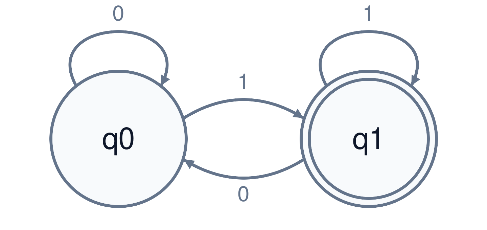

# Automatar

Automatar is a Rust-based finite state automata builder and evaluator. You can input nearly any kind of deterministic finite state machine as a `.fsa` file and also provide an input string `.is` to evaluate against the machine.

The limitations are that the config files are very strict and input strings cannot contain leading or trailing whitespace characters intended to be part of the language, since those characters are trimmed out.

This project was my first real introduction to Rust.

## Example

This machine accepts strings of zeros and ones that end in a one. `q0` is the initial state, and `q1` is the accepting state.

<p align="center">
  
</p>

The config file, `examples/valid/bin_end_1.fsa`:

```text
alphabet: 0 1

accepting: q1

transitions: {
    q0 0 q0
    q0 1 q1

    q1 0 q0
    q1 1 q1
}

initial: q0

states: q0 q1
```

The input string, `examples/valid/bin_end_1.is`:

```text
0110101010110001
```
